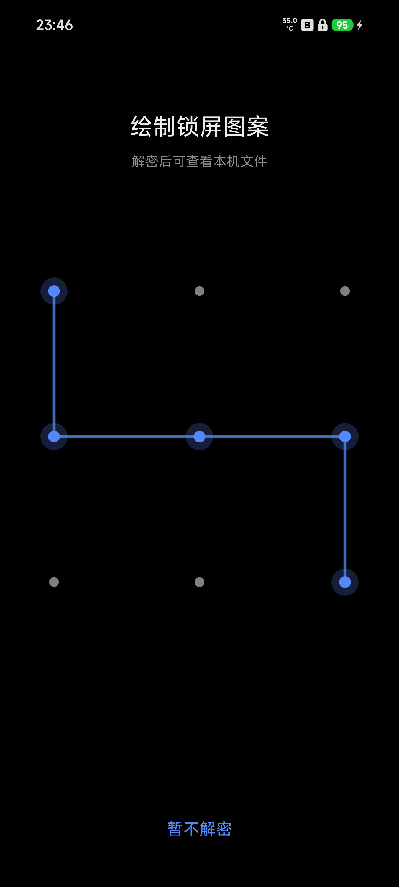
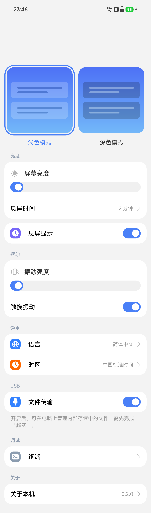
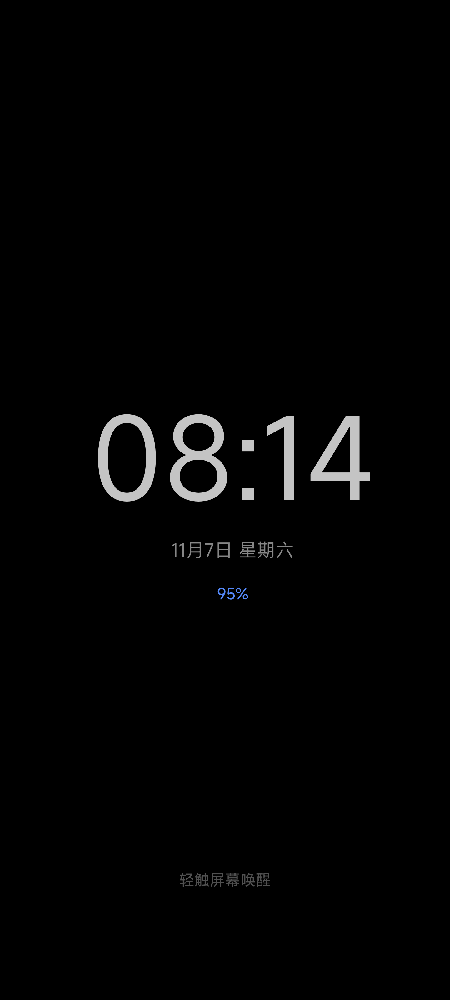
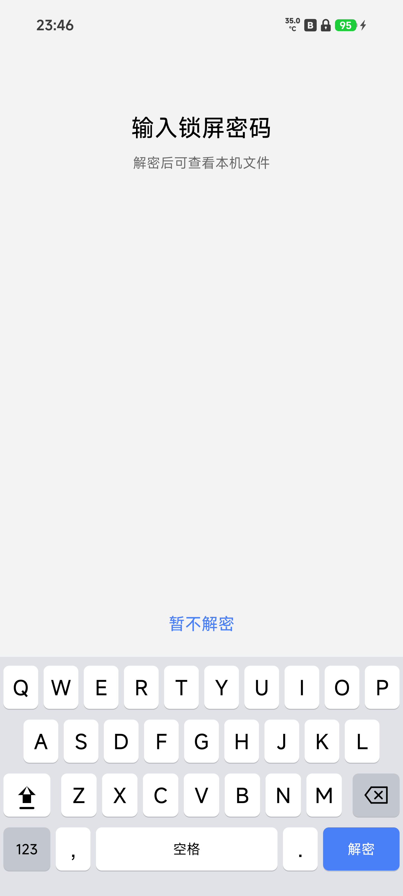

# Skyward for Xiaomi 13 Pro（nuwa）

[English](#english) | 简体中文

基于 [kirklin/skyward](https://github.com/kirklin/skyward) 的第三方移植，让这台机器的
recovery 变成**原生支持 data 解密**的 Skyward。

<p>
  
  
  
  
</p>

| | |
|---|---|
| 当前版本 | `SW-v0.2.0-nuwa-v0.2.0`（上游基线 v0.2.0，本移植第 2 版） |
| 适用机型 | 小米 13 Pro（`nuwa`），已验证 OS3.0.312.0.WMBCNXM / Android 16 / SDK 36 |
| 系统要求 | 已解锁 Bootloader；A/B 分区；独立 `recovery` 分区 |
| 许可 | GPL-3.0（与上游一致） |
| 更新日志 | [CHANGELOG.md](CHANGELOG.md) |

## 这是什么

Skyward 是从零用 Rust 写的第三方 recovery，做法很特别：**不自己驱动硬件，而是借用原厂
recovery 镜像当底座**——保留原厂的 init、adbd、SELinux 策略和硬件相关的 `.so`，只把
`system/bin/recovery` 这一个二进制换成 Skyward 自己的用户态程序，再把页面、安装、备份、
文件管理这些"前端"全部重写。

好处是显示、触摸、存储这些容易出问题的底层全部沿用原厂实现，稳定性和原厂 recovery 一致；
代价是功能边界受原厂底座能力约束（例如能否解密 data，取决于有没有把厂商的 TEE 服务链拉起来）。

本仓库做的是**移植**：为 `nuwa` 补齐配置、把 TEE 服务链拉起来、并补上两个上游没有的小功能。

## 本移植相对上游做了什么

| 改动 | 内容 | 位置 |
|---|---|---|
| **TEE 服务链** | 服务从上游的 3 个补到 8 个：新增 `qseecomd`、`keymint-service-qti`、`hwservicemanager`、`gatekeeper@1.0-service-qti`、`boot@1.2-service`。这是 data 能解密的前提——缺一个，KeyMint 就走不到 TEE | `devices/nuwa.toml` |
| **EFS 备份** | `[backup].efs` 列出 5 个分区：`modemst1`、`modemst2`、`fsg`（IMEI 所在）、`fsc`、`persist` | 同上 |
| **日志导出** | `[wipe].logs`，让「导出日志」能选内部分区 | 同上 |
| **息屏显示 AOD** | 屏幕熄灭后以 2% 背光显示时间、日期、电量，每分钟换一个位置防烧屏，轻触唤醒 | `crates/skyward-ui` |
| **大写锁定** | 双击 Shift 锁定大写（再双击解除），锁定态 Shift 键多一条横杠 | `crates/skyward-ui` |
| **版本号** | About 页显示 `SW-v0.2.0-nuwa-v0.2.0`；更新检查仍用上游版本号 | `crates/skyward-info` |
| **Windows 构建** | 两处可移植性补丁，见 [docs/PATCHES.md](docs/PATCHES.md) | `crates/skyward-bootimg`、`crates/skyward-config` |

上游 `nuwa.toml` 本来就有，但**只有 3 个服务、没有 TEE 链**，所以官方发布的 nuwa 包
能启动、能 Wi-Fi、能备份，但 `/data` 挂不上，也就解不了密。

## 实测情况

以下都在真机（小米 13 Pro，未解密状态下刷入）上跑过：

| 功能 | 结果 |
|---|---|
| 启动 / 显示 / 触摸 | 正常 |
| **data 解密（密码）** | ✅ 通过。TEE 链 6 个服务全部起来，`/data` 以 f2fs 读写挂载，识别出 0/10/999 三个用户；密码错误时报 `the secure world does not recognise that credential`（说明确实走了 TEE，不是本地比对） |
| Wi-Fi（WPA3/SAE） | ✅ 连接成功，拿到 IPv4 + IPv6 |
| 备份 | ✅ 89 MB，`modemst1` 的 SHA-256 与清单一致 |
| 安装 zip | ⚠️ 框架正常，但试的三个包本身不适用（一个缺 `update-binary`，两个要求 `/data/adb/magisk`，本机是 KernelSU） |
| 息屏显示 | ✅ 15 s 无操作后背光 227 → 41（≈2%），轻触唤醒且不穿透点击 |
| 大写锁定 | ✅ 双击锁定/解除，锁定后连续输入仍为大写 |
| 双系统 / OTA 自恢复 | ⬜ 未验证 |
| 振动 / 文件管理 / 终端 | ⬜ 未单独验证 |

## 构建

完整步骤、依赖版本和 Windows 上的坑见 [docs/BUILD.md](docs/BUILD.md)。简要：

```bash
bash build.sh            # 全部：二进制 + 原厂镜像 + 打包
bash build.sh binaries   # 只编二进制
bash build.sh pack       # 只重新打包（复用已有二进制）
```

产物：`upstream/target/out/<VERSION>/skyward-nuwa.img` 及同名 `.sha256`。

```
a432cb572b29355c481f2750c58091aef9060943970266f271a7c56f8aa3b213  skyward-nuwa.img
```

## 刷入与回退

见 [docs/FLASH.md](docs/FLASH.md)。要点：

```bash
adb reboot bootloader
fastboot flash recovery skyward-nuwa.img
fastboot reboot recovery
```

`recovery` 是独立分区（不在 `boot`/`init_boot` 里），所以刷它**不影响系统**，
换回原厂只需刷回自己备份的 `recovery.img`。

## 版本命名

`SW-v<上游版本>-nuwa-v<本移植版本>`，例如：

- `SW-v0.2.0-nuwa-v0.1.0` —— 第一版：打通 TEE 链，data 可解密
- `SW-v0.2.0-nuwa-v0.2.0` —— 第二版：加 AOD、大写锁定、版本号

上游发新版后重新定基，编号随之变成 `SW-v0.3.0-nuwa-v0.1.0` 这样的形式，一眼能看出
基于哪个上游、自己改到第几轮。

## 已知限制

- **AOD 不是真正的低功耗显示**：没有用面板 LPM/doze，期间面板常亮、CPU 也不休眠
  （1 Hz 轮询）。功耗高于手机原生 AOD，但 recovery 场景下可以忽略。
- **只做了一款 AOD 样式**（时间 + 日期 + 电量），没有上游某些移植版的多种时钟样式；
  防烧屏靠每分钟的像素位移，不是靠换样式。
- **更新检查指向上游**：检查的是 `kirklin/skyward` 的 release，不是本移植的版本。

## 许可与致谢

本项目与上游同为 **GPL-3.0**，见 [LICENSE](LICENSE)。修改部分已在
[CHANGELOG.md](CHANGELOG.md) 与 [docs/PATCHES.md](docs/PATCHES.md) 中标明。

- [kirklin/skyward](https://github.com/kirklin/skyward) —— 上游，本移植的全部基础
- MiSans 字体（小米）、KirkMono 字体，见 `upstream/resources/fonts/`

---

## English

A third-party port of [kirklin/skyward](https://github.com/kirklin/skyward) for the
Xiaomi 13 Pro (`nuwa`), version `SW-v0.2.0-nuwa-v0.2.0`.

Skyward reuses the stock recovery image as a substrate — keeping its init, adbd, SELinux
policy and vendor `.so` files — and replaces only `system/bin/recovery` with a Rust program
that redraws the whole UI. This port adds the TEE service chain nuwa needs for data
decryption (upstream's `nuwa.toml` ships without it, so `/data` never mounts), plus an
always-on clock and caps-lock on the on-screen keyboard.

Build with `bash build.sh`; the image lands in `upstream/target/out/<VERSION>/`. See
[docs/BUILD.md](docs/BUILD.md) and [docs/FLASH.md](docs/FLASH.md) (Chinese).
Licensed GPL-3.0, as upstream.
